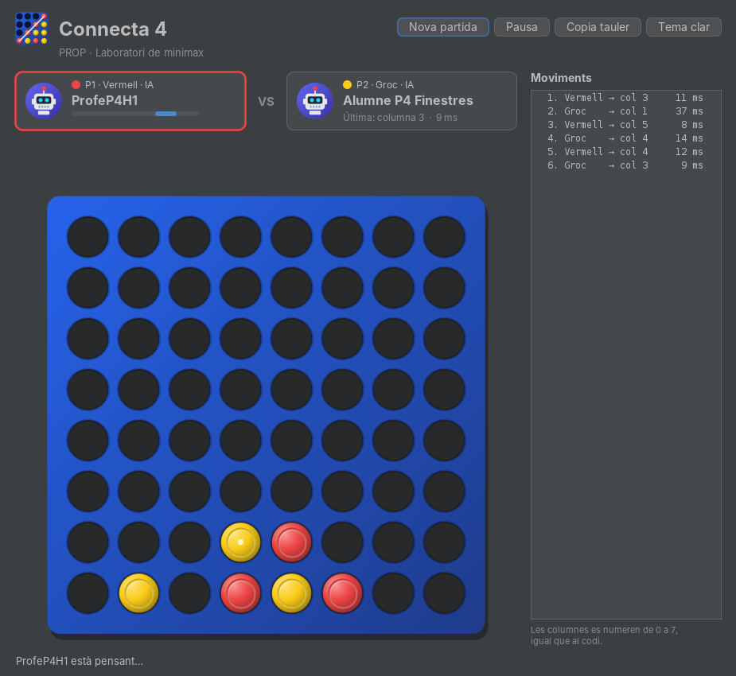
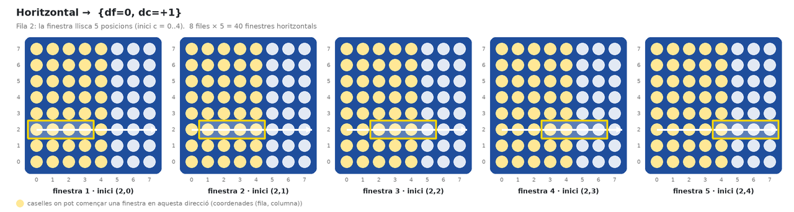
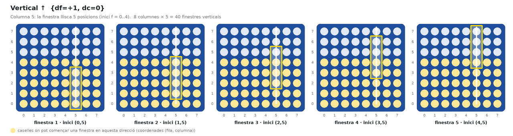
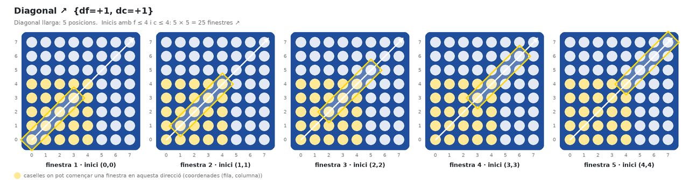
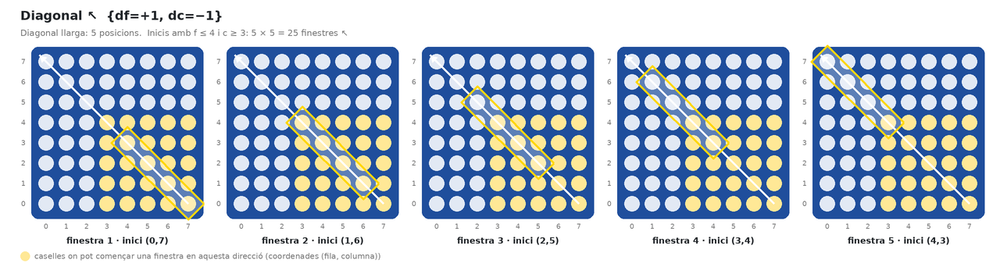

# PROP - Projecte de Programació
## Laboratori de minimax

En aquest laboratori programareu un jugador automàtic de Connecta-4 amb l'algorisme
**minimax**, el millorareu amb la **poda alfa-beta** i experimentareu amb diferents
**heurístiques**. Teniu **dues sessions de
dues hores**. Aquest README és la **guia d'implementació**: què fa cada mètode, l'esquema de l'algorisme,
l'ordre dels passos i, al final, una taula de problemes freqüents. Tingueu-lo obert al costat de l'editor; al codi només hi ha `TODO` que hi apunten.



---

## 1. Què hi ha al projecte

Paquet `edu.epsevg.prop.lab.c4`:


| Fitxer | Què és | L'heu de tocar? |
|---|---|---|
| `jugador/MinimaxPlayer.java` | El vostre jugador minimax: `arrelMinimax`, `max`, `min` | **Sí** (Sessió 1) |
| `jugador/MinimaxAlphaBetaPlayer.java` | El mateix jugador amb poda alfa-beta | **Sí** (Sessió 1, segona part) |
| `jugador/HeuristicaTrivial.java` | Heurística ±∞ / 0 | **Sí** (Sessió 1, és molt curta) |
| `jugador/HeuristicaFinestres.java` | Heurística de finestres de 4 caselles | **Sí** (Sessió 2) |
| `jugador/Heuristica.java` | Interfície comuna de les heurístiques | No |
| `jugador/ManualPlayer.java`, `jugador/RandomPlayer.java` | Jugador humà i jugador aleatori | No |
| `proves/ProvesMinimax.java` | Proves de `MinimaxPlayer` | No |
| `proves/ProvesMinimaxAlphaBeta.java` | Proves de `MinimaxAlphaBetaPlayer`: mateixes jugades que el minimax amb menys nodes | No |
| `proves/ProvesHeuristica.java` | Proves de `HeuristicaFinestres` sobre taulers sencers | No |
| `proves/Proves.java` | Utilitats de les proves (`Proves.tauler(...)`) | No |
| `test/.../jugador/HeuristicaFinestresTest.java` | Tests JUnit pas a pas de l'heurística de finestres | No (però hi podeu afegir tests) |
| `Torneig.java` | Juga moltes partides sense UI i en fa estadístiques (victòries, ms i nodes per moviment) | Només el `main` (Sessió 2) |
| `Juga2.java` | Llança la interfície gràfica | Només el `main`, per triar jugadors |
| `ui/` | Interfície gràfica | No |
| `lib/libc4_obfs.jar` | `c4.Tauler`, `c4.jugador.Jugador`, `c4.jugador.IAuto` i el rival `c4.jugador.ProfePlayer` | No (és ofuscat) |


La documentació de la llibreria (javadoc) és a [`doc/libc4/index.html`](doc/libc4/index.html).

### Com s'executa (NetBeans)

* **Jugar amb la UI**: *Run Project* (F6). Executa `Juga2`.
* **Passar les proves**: botó dret sobre `ProvesMinimax.java`, `ProvesMinimaxAlphaBeta.java`
  o `ProvesHeuristica.java` → *Run File* (Shift+F6).
* **Tests unitaris de l'heurística**: botó dret sobre `HeuristicaFinestresTest.java`
  (a *Test Packages*) → *Test File* (Ctrl+F6). Els jars de JUnit 4 ja són a `lib/`.
* **Fer un torneig**: botó dret sobre `Torneig.java` → *Run File*.

### Què us dona el `Tauler`

```
 fila
  7   . . . . . . . .        t.getColor(f, c)    -> 1, -1 o 0 (buida)
  6   . . . . . . . .        t.movpossible(c)    -> hi cap una fitxa a la columna c?
  5   . . . . . . . .        t.afegeix(c, color) -> deixa caure una fitxa (MODIFICA el tauler!)
  4   . . . . . . . .        t.isGameOver()      -> la partida s'ha acabat? (4 en ratlla o ple)
  3   . . . . . . . .        t.getGuanyador()    -> 1, -1 o 0 (taules); NOMÉS si isGameOver()
  2   . . . . . . . .        t.getMida()         -> 8
  1   . . . . . . . .        new Tauler(t)       -> còpia (no hi ha "desfer"!)
  0   . . . . . . . .
      0 1 2 3 4 5 6 7  columna
```

* La **fila 0 és la de baix**.
* El tauler comprova si la partida s'ha acabat a cada `afegeix` i ho guarda: `isGameOver()`
  és immediat. `getGuanyador()` llança `IllegalStateException` si la partida no s'ha acabat,
  i `afegeix()` també en llança si la partida ja s'ha acabat.
* Els colors són `1` (vermell, comença) i `-1` (groc). El rival de `c` és `-c`.
* La UI numera les columnes de 0 a 7, igual que el codi. El botó **Copia tauler**
  copia la posició actual en el format de `Proves.tauler(...)`, útil per reproduir
  una jugada estranya del vostre jugador en una classe de proves vostra.

---

## 2. Sessió 1 · Minimax i poda alfa-beta amb heurística trivial (2 h)

**Objectiu:** un `MinimaxPlayer` que no perdi mai una partida que es pugui salvar dins
del seu horitzó de cerca i que guanyi quan tingui una victòria a l'abast, i després un
`MinimaxAlphaBetaPlayer` que prengui **exactament les mateixes decisions** explorant
**molts menys nodes**.

> **Com fer servir aquesta guia:** tingueu-la oberta al costat de l'editor i seguiu els
> passos en ordre. Al codi només hi trobareu `// TODO pas N (README 2.1)` al lloc on va
> cada pas.

### Planificació orientativa

| Temps | Activitat |
|---|---|
| 0:00 – 0:10 | Obriu el projecte, executeu `Juga2` i jugueu una partida contra `new ProfePlayer(4, false)`. Llegiu la secció 2.1 sencera. |
| 0:10 – 0:55 | Passos 1–4 de la secció 2.1 (`MinimaxPlayer` i `HeuristicaTrivial`). |
| 0:55 – 1:05 | `ProvesMinimax` tot en verd. |
| 1:05 – 1:40 | Secció 2.2: alfa-beta. `ProvesMinimaxAlphaBeta` tot en verd. |
| 1:40 – 2:00 | Experiments i preguntes (secció 2.3). |

### 2.1 Minimax (`MinimaxPlayer`)

#### Convencions

* Colors `1` i `-1`; el rival de `colorJo` és `colorRival = -colorJo`. Tots dos camps ja
  s'assignen a `moviment()`.
* **Profunditat** = nombre de *mitges jugades* (plies) que mirem endavant, comptant els
  meus moviments i els del rival per separat. Profunditat 1 = només miro els meus
  moviments possibles.
* `arrelMinimax` retorna una **columna**; `max` i `min` retornen un **valor**.
* Els valors sempre són **des del punt de vista de `colorJo`** (positiu = bo per a mi).
* `INFINIT = 1_000_000_000`, molt més gran que qualsevol heurística.

#### `arrelMinimax(t, prof)`: tria la columna

Prova cadascuna de les meves jugades, demana a `min` quant val el tauler resultant i es
queda amb la **columna** de la millor. L'esquema del bucle:

```java
// prepara on guardaràs el millor valor i la millor columna
for (int c = 0; c < t.getMida(); c++) {
    if (!t.movpossible(c)) continue;
    Tauler fill = new Tauler(t);
    // tira la meva fitxa al fill
    // avalua el fill (ara li toca al rival)
    // si és millor que el que tenies, recorda el valor i la columna
}
// retorna la millor columna
```

*Pregunta:* quina columna retornes si **totes** les jugades perden (totes valen −∞)?

#### `valorTerminal(t)`: valor d'una partida acabada

Mètode privat nou (no és a la plantilla). Només es crida quan la partida s'ha acabat:
+∞ si he guanyat jo, −∞ si ha guanyat el rival, 0 si són taules.
*Funcions:* `getGuanyador()`.

#### `max(t, prof)`: em toca a mi

```text
MAX(t, prof)
  si la partida s'ha acabat        → retorna el valor terminal
  si no queda profunditat          → retorna l'heurística
  per a cada columna jugable:
      genera el fill amb la meva fitxa
      avalua'l amb MIN
      queda't amb el millor
  retorna el millor
```

*Funcions:* `isGameOver()`, `movpossible(c)`, `new Tauler(t)`, `afegeix(c, color)`,
`heuristica.avalua(t, colorJo)`.
*Preguntes:* amb quin valor comences "el millor"? Importa l'ordre dels dos primers "si"?
Des del punt de vista de qui s'avalua l'heurística?

#### `min(t, prof)`: li toca al rival

És el **mirall** de `max`. *Preguntes:* de qui és la fitxa que poses als fills? Amb quin
valor comences? I l'heurística, des de quin punt de vista l'avalues?

#### Ordre d'implementació

1. **`valorTerminal`**.
2. **`max`** i, quan el tingueu, **`min`**.
3. **`arrelMinimax`**: esborreu el codi provisional.
4. **`HeuristicaTrivial`**: `h = +∞ si guanyo, −∞ si perdo, 0 altrament`. Però fixeu-vos
   que els dos primers casos són estats terminals: qui els resol, i abans o després de
   cridar l'heurística? Quan s'arriba a `avalua`, què queda per detectar?
5. Executeu **`ProvesMinimax`**. Comproven que exploreu **tot** l'arbre (tauler buit,
   profunditat 4 = 8 + 64 + 512 + 4096 = 4680 nodes), que guanyeu en 1 jugada, que
   bloquegeu una amenaça, que trobeu una doble amenaça, que **sempre** retorneu un
   moviment legal (fins i tot quan totes les jugades perden) i que funcioneu amb tots dos
   colors. Si falla la prova de nodes, comenceu per aquí: la resta en sol dependre.

Si alguna cosa no va, mireu la taula de la secció 4.

### 2.2 Alfa-beta (`MinimaxAlphaBetaPlayer`)

#### Què signifiquen alfa i beta

* `alfa`: el millor valor que **MAX** (jo) ja té garantit en algun punt del camí des de
  l'arrel fins a aquest node. MAX no acceptarà res pitjor.
* `beta`: el millor valor (el més petit) que **MIN** (el rival) ja té garantit en el camí.
  MIN no deixarà que MAX obtingui res millor.
* Si en algun moment `alfa >= beta`, la resta de fills d'aquest node no poden canviar la
  decisió de l'arrel: **es poden** (deixem d'explorar-los).

#### Què canvia respecte del minimax

Només tres coses, a `max` i a `min`:

1. **Paràmetres:** reben `alfa` i `beta` i els passen a la crida recursiva.
2. **Actualització:** a `max`, `alfa` fa la feina de "el millor fins ara"; a `min`, la fa
   `beta`.
3. **Tall:** després d'avaluar cada fill, si `alfa >= beta`, no mireu més germans i
   retorneu.

A `arrelMinimax` també hi intervenen alfa i beta. *Preguntes:* què fa d'`alfa` a l'arrel? Quins
límits passeu als fills: sempre (−∞, +∞) o els actuals? Per actualitzar la millor columna,
compareu amb `>` o amb `>=`? (Penseu què retorna un fill que ha estat podat.)

#### Ordre d'implementació

1. Quan `ProvesMinimax` surti tot en verd, copieu el cos d'`arrelMinimax`, `max`, `min` i
   el vostre `valorTerminal` de `MinimaxPlayer` a `MinimaxAlphaBetaPlayer`. Les signatures
   ja tenen els paràmetres `alfa` i `beta`.
2. Adapteu **`max`** i **`min`** (els tres canvis de dalt).
3. Adapteu **`arrelMinimax`**.
4. Executeu **`ProvesMinimaxAlphaBeta`**. Fa servir el **vostre** `MinimaxPlayer` com a
   referència (per això `ProvesMinimax` ha d'estar en verd abans): repeteix les proves
   tàctiques, comprova que exploreu menys nodes que el minimax i que, en 250 posicions
   aleatòries per heurística, trieu **exactament la mateixa columna**.

### 2.3 Experiments i preguntes de la Sessió 1

Configureu el `main` de `Juga2` i jugueu-hi:

1. `new ManualPlayer()` contra `new MinimaxPlayer(2, new HeuristicaTrivial())`. Intenteu
   guanyar-li. Quina columna tria quan no veu cap victòria ni derrota? Per què?
2. Mireu la consola: nodes i temps per moviment de `MinimaxPlayer` i de
   `MinimaxAlphaBetaPlayer` a profunditats 4, 6 i 8. Quin percentatge de nodes estalvia la
   poda? Fins a quina profunditat podeu jugar còmodament amb cadascun?
3. `new MinimaxAlphaBetaPlayer(6, new HeuristicaTrivial())` contra `new ProfePlayer(4, false)`.
   Què passa? Per què un jugador que "no s'equivoca mai" dins del seu horitzó perd igualment?
4. Amb +∞ per a qualsevol victòria, el vostre jugador distingeix entre guanyar en
   1 jugada o en 5? Ho heu vist passar a la partida? (Ho reprendrem a la Sessió 2.)

**Abans de marxar:** `ProvesMinimax` i `ProvesMinimaxAlphaBeta` en verd, i les respostes
1–4 apuntades.

---

## 3. Sessió 2 · Heurística de finestres i experimentació (2 h)

**Objectiu:** una heurística que valori les posicions no terminals, mesurar quant
millora el jugador i veure com l'ordre d'exploració afecta la poda.

### Planificació orientativa

| Temps | Activitat |
|---|---|
| 0:00 – 0:10 | Posada en comú de les preguntes de la Sessió 1. |
| 0:10 – 0:35 | Pas 1 de la secció 3.1 (`puntuaFinestra`): tests `pas1_*` de `HeuristicaFinestresTest`. |
| 0:35 – 0:55 | Pas 2 (`avalua`): tests `pas2_*`. `ProvesHeuristica` en verd. |
| 0:55 – 1:15 | Secció 3.2: ordre d'exploració i poda. |
| 1:15 – 1:50 | Experiments amb `Torneig` (secció 3.3). |
| 1:50 – 2:00 | Conclusions i, si queda temps, una millora opcional (secció 3.4). |

### 3.1 Heurística de finestres (`HeuristicaFinestres`)

Una **finestra** és un grup de 4 caselles consecutives en horitzontal, vertical,
diagonal ↗ o diagonal ↖: cadascuna és una possible línia guanyadora. Per a cada finestra:

| Contingut | Punts |
|---|---|
| 2 fitxes meves + 2 buides | +100 (`PUNTS_2`) |
| 3 fitxes meves + 1 buida | +1000 (`PUNTS_3`) |
| 2 fitxes del rival + 2 buides | −100 |
| 3 fitxes del rival + 1 buida | −1000 |
| Qualsevol altra cosa (barrejada, 0–1 fitxes) | 0 |

L'heurística és la **suma** de totes les finestres del tauler. Les finestres amb 4 fitxes
iguals no cal puntuar-les: si algú ha fet 4 en ratlla, el minimax ja ho ha detectat amb
`isGameOver()` abans de cridar l'heurística.

#### La finestra lliscant

Cada direcció és un parell `{df, dc}` de `DIRECCIONS` (la fila 0 és la de baix: `df = +1`
vol dir *pujar*). Una finestra es defineix per la seva **casella d'inici** `(f, c)` i la
direcció; les seves caselles són `(f + i·df, c + i·dc)` per a `i = 0..3`. Cada dibuix
mostra una línia del tauler (en blanc) i el **marc groc** de la finestra lliscant pas a
pas, de la posició 1 a la 5. En groc clar hi ha **totes** les caselles on pot començar una
finestra en aquella direcció: comptar-les és comptar les finestres.









En total: 40 + 40 + 25 + 25 = **130 finestres** en un tauler 8×8.

#### `avalua(t, colorJo)`: tot el tauler

Cada casella `(f, c)` és un possible **inici** de finestra. Per a cadascuna i per a cada
direcció de `DIRECCIONS`, comproveu si la finestra hi cap mirant si la seva **última**
casella és dins del tauler; si hi cap, sumeu-ne la puntuació.
*Funcions:* `dinsTauler(t, f, c)`, `puntuaFinestra(...)`.
*Pregunta:* per què n'hi ha prou amb 4 direccions i no 8?

#### `puntuaFinestra(t, f, c, df, dc, colorJo)`: una finestra

Recorreu les 4 caselles de la finestra, compteu quantes són meves, quantes del rival i
quantes buides, i decidiu la puntuació amb la taula de dalt.
*Funcions:* `t.getColor(f, c)`, `PUNTS_2`, `PUNTS_3`, `N`.

#### Ordre d'implementació

1. **`puntuaFinestra`**. Passeu els tests `pas1_*` de `HeuristicaFinestresTest` (botó dret
   → *Test File*, Ctrl+F6). Van en ordre (`pas1a`, `pas1b`, …) i cada missatge d'error diu
   quina finestra, direcció i color fallen.
2. **`avalua`**. Passeu els tests `pas2_*`. El primer comprova que visiteu **exactament
   130 finestres**: recorreu tot el tauler, sense dreceres.
3. Executeu **`ProvesHeuristica`** (taulers sencers). Si un test us sembla que està
   malament, feu el càlcul a mà sobre el tauler del test abans de tocar-lo.

### 3.2 Ordre d'exploració i poda (punt a verificar)

L'alfa-beta poda més com més aviat troba la millor jugada. A Connecta-4 les columnes
centrals solen ser les millors (formen part de més finestres), però el vostre jugador les
explora en ordre 0, 1, 2, …, 7.

`MinimaxAlphaBetaPlayer` ja té un camp `ordre` i un segon constructor:

```java
new MinimaxAlphaBetaPlayer(6, new HeuristicaFinestres());                 // ordre 0..7
new MinimaxAlphaBetaPlayer(6, new HeuristicaFinestres(),
                           MinimaxAlphaBetaPlayer.ORDRE_CENTRE);           // 3,4,2,5,1,6,0,7
```

1. Canvieu els tres bucles (`arrelMinimax`, `max`, `min`) perquè recorrin `ordre`:
   `for (int c : ordre) { if (!t.movpossible(c)) continue; ... }`. Amb el constructor de
   dos paràmetres l'ordre és 0..7, així que `ProvesMinimaxAlphaBeta` ha de continuar en verd.
2. Feu un `Torneig` del jugador ordenat contra el no ordenat (P6 i P8, Finestres i
   Trivial) i apunteu la columna **nodes/moviment**:

   | Jugador | Nodes/mov 0..7 | Nodes/mov centre | Estalvi |
   |---|---|---|---|
   | AlfaBeta P6 Trivial | | | |
   | AlfaBeta P6 Finestres | | | |
   | AlfaBeta P8 Finestres | | | |

3. Preguntes: amb quina heurística millora més la poda? Per què? Els dos jugadors fan
   sempre la mateixa jugada? (Pista: què passa quan dues columnes valen el mateix?)
   Canvia el resultat de les partides?

### 3.3 Experiments amb `Torneig`

Al `main` de `Torneig` trieu els dos jugadors (feu servir `MinimaxAlphaBetaPlayer`: va
molt més ràpid i pren les mateixes decisions). Cada torneig juga 20 partides alternant
qui comença; les 2 primeres jugades de cada partida són aleatòries (amb llavor fixa)
perquè no surtin 20 partides idèntiques. Ompliu la taula:

| # | Jugador A | Jugador B | Guanya A | Taules | Guanya B | ms/mov A | ms/mov B |
|---|---|---|---|---|---|---|---|
| 1 | AlfaBeta P4 Trivial | AlfaBeta P4 Finestres | | | | | |
| 2 | AlfaBeta P2 Finestres | AlfaBeta P6 Trivial | | | | | |
| 3 | AlfaBeta P4 Finestres | `ProfePlayer(4, false)` | | | | | |
| 4 | AlfaBeta P4 Finestres | `ProfePlayer(4, true)` | | | | | |
| 5 | AlfaBeta P6 Finestres | `ProfePlayer(6, false)` | | | | | |
| 6 | AlfaBeta P5 Finestres | AlfaBeta P6 Finestres | | | | | |
| 7 | AlfaBeta P8 Finestres (ordenat) | `ProfePlayer(8, false)` | | | | | |

Preguntes:

1. Una heurística "bona" a profunditat 2 pot guanyar una heurística trivial a
   profunditat 6? Què us diu això sobre *mirar lluny* vs *valorar bé*?
2. Com creix el temps per moviment en passar de profunditat 4 a 5 a 6? Quin factor
   de ramificació efectiu en deduïu, amb i sense poda? (Orientatiu: sense poda, P6 ≈ 0,3 M
   nodes i P8 ≈ 19 M nodes.)
3. Profunditats parelles i senars: es comporta igual P5 que P6? Per què pot passar
   que la profunditat senar sigui més "optimista"?
4. Les finestres valoren igual una amenaça a la fila de baix (jugable ara mateix) que
   una a la fila 6 amb la columna buida a sota. És un problema? Com ho arreglaríeu?

### 3.4 Millores opcionals (si acabeu abans)

* **Guanyar ràpid:** retorneu `INFINIT + prof` en lloc d'`INFINIT` a les victòries
  (i `-INFINIT - prof` a les derrotes). Què canvia al joc?
* **Ordre dinàmic:** en lloc d'un ordre fix, ordeneu els fills de cada node per
  l'heurística (o proveu primer la millor jugada de la iteració anterior). Compensa el
  cost d'ordenar?
* **Pesos i gravetat:** proveu altres pesos (per exemple 10/100) o premieu només les
  finestres on la casella buida es pot jugar ja. Mesureu-ho amb `Torneig`, no a ull.

---

## 4. Problemes freqüents

Feu servir aquesta taula quan una prova falli o el jugador faci alguna cosa estranya.

**Minimax**

| Símptoma | Causa probable |
|---|---|
| La UI diu "moviment il·legal (columna -1)" | `arrelMinimax` no inicialitza la millor columna amb una columna vàlida i totes les jugades valen −∞. |
| El jugador posa fitxes "fantasma" o el tauler canvia sol | Heu fet `afegeix` sobre `t` en lloc d'una còpia. |
| No bloqueja una amenaça evident a profunditat ≥ 2 | A `min` poseu fitxes de `colorJo`, o el valor terminal té el signe girat. |
| No veu una victòria (o una derrota) a l'última jugada de l'horitzó | Comproveu `prof == 0` abans d'`isGameOver()`. |
| `IllegalStateException: La partida encara no s'ha acabat` | Crideu `getGuanyador()` sense comprovar abans `isGameOver()`. |
| `IllegalStateException: La partida ja s'ha acabat` | Expandiu fills d'un node terminal: falta comprovar `isGameOver()` al principi de `max`/`min`. |
| Juga bé amb vermelles i malament amb grogues | Heu escrit `1` o `-1` al codi en lloc de `colorJo` / `colorRival`, o a `min` avalueu l'heurística amb `colorRival`. |
| La prova de nodes no dona 4680 | No exploreu totes les columnes, no decrementeu `prof` a cada nivell, o talleu abans d'hora. |
| Va molt lent | Profunditat massa gran per a un minimax sense poda (vegeu 3.3, pregunta 2). |

**Alfa-beta**

| Símptoma | Causa probable |
|---|---|
| Explora els mateixos nodes que el minimax | No talleu, o no passeu `alfa` i `beta` a les crides recursives. |
| No poda res a profunditat 2 | L'arrel crida els fills sempre amb (−∞, +∞) en lloc de passar-los l'`alfa` actual. |
| Tria columnes diferents del minimax | A l'arrel compareu amb `>=` en lloc de `>` (un fill podat pot valer exactament `alfa`), o després d'un tall retorneu un valor que no és `alfa`/`beta`. |
| Poda, però menys del que esperàveu | Talleu amb `alfa > beta` en lloc de `alfa >= beta`. No és un error (dona les mateixes jugades), però poda menys. |

**Heurística de finestres**

| Símptoma | Causa probable |
|---|---|
| La prova de les 130 finestres dona 260 (o els valors us surten dobles) | Recorreu 8 direccions: cada finestra es compta dues vegades. |
| La prova de les 130 finestres dona menys, o `ArrayIndexOutOfBoundsException` | Comproveu els límits amb la **primera** casella de la finestra en lloc de l'**última**. |
| Una finestra amb fitxes dels dos colors dona punts | Una finestra barrejada no serveix a ningú: val 0. |
| `avalua(t, 1) != -avalua(t, -1)` | Signe girat per al rival, o heu escrit `1` en lloc de `colorJo`. |
| Una finestra amb 4 fitxes iguals dona punts | No cal puntuar-la: és un estat terminal i el minimax ja l'ha resolt. |
